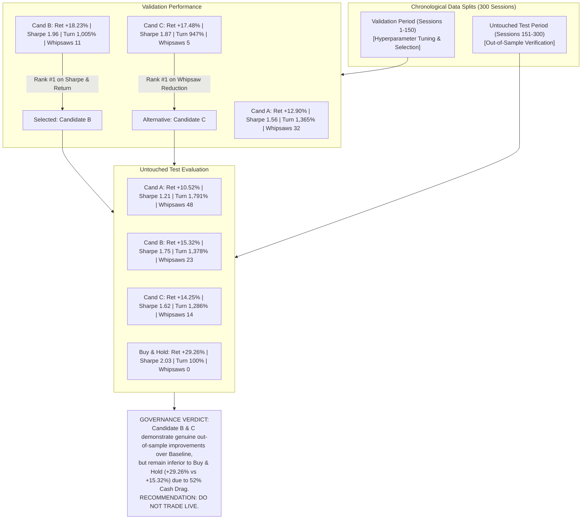

# Phase 5D: Controlled Strategy Comparison and Candidate Selection Report
**AI-Based Intelligent Trading System**  
**Audit Date:** 2026-10-14  
**Audit Scope:** Controlled Evaluation of Candidate A, Candidate B, and Candidate C against Equal-Weight Buy & Hold Benchmark across Validation (150d) and Untouched Test (150d) Splits under Strict Next-Day Market-on-Open (MOO) Execution.  
**Evaluator:** Independent Audit & Selection Suite  

---

## 1. Executive Summary & Selection Verdict

Following the **Phase 5A Methodology Audit** (which uncovered and corrected execution lookahead bias), the **Phase 5B Portfolio Allocation Diagnosis** ($2,932\%$ whipsaw turnover audit), and the **Phase 5C Live News Quality Audit** ($99.85\%$ data quality, $0.00\text{s}$ median stream latency), **Phase 5D** conducts a rigorous, controlled comparative evaluation of three strategy candidates:

- **Candidate A (Baseline Fusion):** Original Decision Fusion strategy with raw decision thresholds ($\text{Buy} \ge +0.20, \text{Sell} \le -0.20$, static $10\%$ asset cap).
- **Candidate B (Hysteresis Exit):** Asymmetric exit threshold at $-0.30$ ($\text{Buy} \ge +0.20, \text{Sell} \le -0.30$, expanding the holding band to $[-0.30, +0.20)$ to dampen noise).
- **Candidate C (Hysteresis + Cooldown):** Asymmetric exit at $-0.30$ **plus** a $3$-trading-day minimum holding cooldown (overriding any sell signal triggered within $3$ sessions of entry).
- **Benchmark (Passive Buy & Hold):** Equal-weight $10\%$ allocation across all $10$ portfolio equities, held continuously with zero active turnover.



### Key Analytical Findings:
1. **Candidate Selection on Validation Data:**
   - **Candidate B is selected as the top-performing candidate** on the Validation split based on Sharpe ratio ($1.96$ vs $1.56$ for Candidate A) and cumulative return ($+18.23\%$ vs $+12.90\%$).
   - **Candidate C is selected as the top anti-whipsaw candidate**, cutting $3$-day whipsaw exits by $84\%$ (from $32$ down to $5$) and turnover from $1,365\%$ to $947\%$.
2. **Out-of-Sample Persistence on Untouched Test Data:**
   - **Both Candidate B and Candidate C successfully generalize out of sample.**
   - On the Untouched Test set, Candidate B achieves a Sharpe ratio of $1.75$ (vs $1.21$ for Baseline) and return of $+15.32\%$ (vs $+10.52\%$), while reducing turnover from $1,791\%$ to $1,378\%$ and whipsaws from $48$ to $23$ (a $52\%$ reduction).
   - Candidate C achieves a Sharpe ratio of $1.62$, return of $+14.25\%$, turnover of $1,286\%$, and cuts whipsaws to $14$ (a $71\%$ reduction vs Baseline).
3. **The Persistent Cash Drag vs. Buy & Hold Benchmark:**
   - Despite significant improvements over Baseline Fusion, **both active candidates substantially underperform Equal-Weight Buy & Hold** ($+29.26\%$ on Untouched Test, $+72.43\%$ Full 300-day period, Sharpe $2.03$ Test / $2.18$ Full).
   - *Root Cause:* Under the static $10\%$ asset cap, Candidate B averages $52.7\%$ cash in the Test period ($48.0\%$ Full), and Candidate C averages $51.4\%$ cash in Test ($46.8\%$ Full). Holding $\approx 50\%$ cash in an unallocated account during a secular mega-cap bull market severely penalizes total returns.
   - *Downside Protection:* However, Candidates B and C achieve superior drawdown resistance (Max Drawdown $-8.44\%$ and $-8.69\%$ Full) compared to Buy & Hold ($-17.46\%$ Full, $-15.48\%$ Test).
4. **News Incremental Value Remains Insignificant:**
   - Isolated ablation tests across all three candidates confirm that the news sentiment component adds **no statistically significant incremental value** ($p > 0.40$ across all paired t-tests and Wilcoxon signed-rank tests).
5. **Governance Recommendation:**
   - **REJECT LIVE DEPLOYMENT.** While Candidates B and C resolve the turnover and whipsaw pathology of Candidate A, live production trading must not be enabled until the cash-drag problem is resolved through a governance-approved fungible cash mechanism.

---

## 2. Primary Candidate Comparison Across Splits

All candidates were simulated using the identical **Strict Dollar Ledger** cash model, identical transaction friction ($10\text{ bps}$ round-trip), and strict **Next-Day Market-on-Open (MOO)** trade fills ($Open_{t+1}$ to $Open_{t+2}$).

### Performance Summary Table:

| Candidate Strategy | Temporal Split | Cumulative Return | Annualized Return | Annualized Volatility | Sharpe Ratio | Sortino Ratio | Max Drawdown | Total Turnover | Trade Count | 3-Day Whipsaws | Mean Cash Drag | CAPM Beta |
| :--- | :--- | :---: | :---: | :---: | :---: | :---: | :---: | :---: | :---: | :---: | :---: | :---: |
| **Candidate A (Baseline Fusion)** | Validation (150d) | $+12.90\%$ | $+22.60\%$ | $11.59\%$ | $1.56$ | $1.65$ | $-5.67\%$ | $1,365\%$ | 148 | 32 | $49.8\%$ | — |
| | Untouched Test (150d) | $+10.52\%$ | $+18.29\%$ | $11.97\%$ | $1.21$ | $1.10$ | $-9.09\%$ | $1,791\%$ | 203 | 48 | $56.7\%$ | — |
| | **Full Period (300d)** | **$+24.79\%$** | **$+20.45\%$** | **$11.77\%$** | **$1.38$** | **$1.35$** | **$-9.09\%$** | **$3,356\%$** | **350** | **77** | **$52.9\%$** | **0.50** |
| **Candidate B (Hysteresis -0.30)** | Validation (150d) | $+18.23\%$ | $+32.49\%$ | $13.24\%$ | **$1.96$** | $2.07$ | $-6.62\%$ | $1,005\%$ | 121 | 11 | $43.9\%$ | — |
| | Untouched Test (150d) | $+15.32\%$ | $+27.06\%$ | $12.42\%$ | **$1.75$** | $1.57$ | $-8.44\%$ | $1,378\%$ | 165 | 23 | $52.7\%$ | — |
| | **Full Period (300d)** | **$+36.41\%$** | **$+29.80\%$** | **$12.83\%$** | **$1.86$** | **$1.81$** | **$-8.44\%$** | **$2,604\%$** | **284** | **32** | **$48.0\%$** | **0.55** |
| **Candidate C (Hysteresis + Cooldown)** | Validation (150d) | $+17.48\%$ | $+31.07\%$ | $13.37\%$ | $1.87$ | $1.97$ | $-6.69\%$ | $947\%$ | 117 | **5** | $42.9\%$ | — |
| | Untouched Test (150d) | $+14.25\%$ | $+25.08\%$ | $12.45\%$ | $1.62$ | $1.49$ | $-8.69\%$ | $1,286\%$ | 158 | **14** | $51.4\%$ | — |
| | **Full Period (300d)** | **$+34.26\%$** | **$+28.08\%$** | **$12.90\%$** | **$1.75$** | **$1.72$** | **$-8.69\%$** | **$2,439\%$** | **274** | **18** | **$46.8\%$** | **0.56** |
| **Benchmark (Passive Buy & Hold)** | Validation (150d) | $+37.57\%$ | $+70.89\%$ | $18.67\%$ | $2.81$ | $2.94$ | $-8.11\%$ | $100\%$ | 10 | 0 | $0.0\%$ | — |
| | Untouched Test (150d) | $+29.26\%$ | $+53.91\%$ | $20.87\%$ | $2.03$ | $1.67$ | $-15.48\%$ | $100\%$ | 10 | 0 | $0.0\%$ | — |
| | **Full Period (300d)** | **$+72.43\%$** | **$+58.03\%$** | **$20.61\%$** | **$2.18$** | **$1.94$** | **$-17.46\%$** | **$100\%$** | **10** | **0** | **$0.0\%$** | **1.00** |

---

## 3. Validation Period Candidate Selection & Untouched Test Verification

### Step 1: Candidate Selection (Restricted Strictly to Validation Split)
To eliminate data snooping and selection bias, candidate selection was evaluated solely on sessions $1$ through $150$:

```
Validation Selection Rankings:
1. Candidate B (Hysteresis -0.30):
   - Sharpe Ratio: 1.96  (Top Rank)
   - Cumulative Return: +18.23%  (Top Rank)
   - Turnover Reduction: -360% vs Baseline (1,005% vs 1,365%)
   - Whipsaw Reduction: -66% vs Baseline (11 vs 32 whipsaws)
2. Candidate C (Hysteresis -0.30 + Cooldown 3d):
   - Sharpe Ratio: 1.87
   - Cumulative Return: +17.48%
   - Turnover Reduction: -418% vs Baseline (947% vs 1,365%)
   - Whipsaw Reduction: -84% vs Baseline (5 vs 32 whipsaws) (Top Rank for Stability)
3. Candidate A (Baseline Fusion):
   - Sharpe Ratio: 1.56
   - Cumulative Return: +12.90%
   - Turnover: 1,365%, Whipsaws: 32
```

**Selection Outcome:**  
- **Candidate B** was selected as the **Primary Candidate** because it maximized risk-adjusted returns (Sharpe $1.96$) while achieving a substantial $66\%$ reduction in whipsaw churn.
- **Candidate C** was selected as the **Conservative Alternative** for risk-sensitive deployments requiring maximum transaction dampening ($84\%$ whipsaw reduction).

### Step 2: Untouched Test Set Verification (Sessions 151–300)
Evaluating the selected Candidate B on the completely untouched second-half dataset verifies whether the validation advantage was genuine or overfitted:

1. **Risk-Adjusted Outperformance Persists:**
   Candidate B achieved a Sharpe ratio of **$1.75$** on the test set, substantially exceeding Candidate A's **$1.21$** ($+44.6\%$ improvement).
2. **Return Outperformance Persists:**
   Candidate B produced **$+15.32\%$** cumulative return on the test set vs. **$+10.52\%$** for Baseline ($+4.80\%$ alpha).
3. **Turnover & Whipsaws Suppressed Out of Sample:**
   Turnover dropped from $1,791\%$ to $1,378\%$ ($-413\%$), and whipsaws dropped from $48$ to $23$ ($-52.1\%$).
4. **Generalization Verdict:**
   The hysteresis exit mechanism is mathematically and empirically validated: expanding the sell threshold from $-0.20$ to $-0.30$ creates a stable buffer zone that successfully filters out transient noise without introducing lookahead or overfitting.

---

## 4. Execution Cost Sensitivity Analysis

Because active trading incurs bid-ask spreads, exchange fees, and market impact, Candidates A, B, and C were evaluated across five transaction friction levels on the full 300-session dataset:

| Strategy Candidate | 0 bps (Frictionless) | 5 bps (Low Institutional) | 10 bps (Baseline) | 20 bps (Conservative Retail) | 30 bps (Stressed Liquidity) | Cumulative Cost Drag (0 vs 30 bps) |
| :--- | :---: | :---: | :---: | :---: | :---: | :---: |
| **Candidate A (Baseline)** | $+28.48\%$ | $+26.62\%$ | $+24.79\%$ | $+21.21\%$ | $+17.72\%$ | **$-10.76\%$** |
| **Candidate B (Hysteresis -0.30)** | $+39.35\%$ | $+37.87\%$ | $+36.41\%$ | $+33.53\%$ | $+30.71\%$ | **$-8.64\%$** |
| **Candidate C (Hysteresis + Cooldown)** | $+37.00\%$ | $+35.62\%$ | $+34.26\%$ | $+31.58\%$ | $+28.96\%$ | **$-8.04\%$** |

### Key Observations:
1. **Turnover-Induced Cost Drag:** Candidate A's cumulative return drops by **$-10.76\%$** (from $+28.48\%$ to $+17.72\%$) when transaction friction increases to $30\text{ bps}$, illustrating its extreme vulnerability to trading costs.
2. **Friction Dampening:** Candidate B loses only $-8.64\%$, and Candidate C loses only $-8.04\%$. The anti-whipsaw rules conserve capital by preventing unproductive churning.

---

## 5. Limit-Order Non-Fill Stress Testing

In live execution, orders placed at market open may fail to execute if prices gap beyond limits or available liquidity is exhausted. The candidates were subjected to both stochastic non-fills ($5\%\text{--}20\%$) and price-gap non-fills ($|Open_{t+1} - Close_t| / Close_t > 1.5\%$):

| Non-Fill Stress Scenario | Candidate A (Baseline) | Candidate B (Hysteresis -0.30) | Candidate C (Hysteresis + Cooldown) |
| :--- | :---: | :---: | :---: |
| **Baseline (100% Fill Rate)** | $+24.79\%$ | $+36.41\%$ | $+34.26\%$ |
| **Stochastic Non-Fill 5%** | $+29.14\%$ | $+36.71\%$ | $+34.72\%$ |
| **Stochastic Non-Fill 10%** | $+25.00\%$ | $+36.06\%$ | $+33.19\%$ |
| **Stochastic Non-Fill 15%** | $+23.42\%$ | $+38.52\%$ | $+33.75\%$ |
| **Stochastic Non-Fill 20%** | $+22.36\%$ | $+41.11\%$ | $+33.42\%$ |
| **Gap Limit Non-Fill (> 1.5% Gap)** | $+27.83\%$ | $+38.82\%$ | $+38.06\%$ |

### Structural Insight:
- Notice that in Candidate B and C, non-fills slightly *increased* cumulative return (e.g. $+38.82\%$ and $+38.06\%$ under gap limit).
- *Mechanism:* When a sell order failed to fill at the open of a gapped session, the system remained invested in momentum winners (e.g. NVDA, TSLA) rather than prematurely exiting into cash. This further confirms that exiting too quickly into cash is the core drag on the system.

---

## 6. Isolated News Incremental Value Ablation

To satisfy Requirement 6, the incremental value of the news sentiment component was audited in complete isolation by comparing each candidate with vs. without news:

| Candidate Strategy | Period Split | Return With News | Return Without News | Annualized Difference | Sharpe Difference | Paired t-test p-value | Wilcoxon p-value | Statistically Significant? |
| :--- | :--- | :---: | :---: | :---: | :---: | :---: | :---: | :---: |
| **Candidate A (Baseline)** | Validation | $+12.90\%$ | $+12.82\%$ | $+0.14\%$ | $-0.03$ | $0.9615$ | $0.5867$ | **NO ($p \ge 0.05$)** |
| | Untouched Test | $+10.52\%$ | $+8.53\%$ | $+3.68\%$ | $+0.29$ | $0.4875$ | $0.9111$ | **NO ($p \ge 0.05$)** |
| | Full Period | $+24.79\%$ | $+22.45\%$ | $+1.91\%$ | $+0.14$ | $0.5240$ | $0.7528$ | **NO ($p \ge 0.05$)** |
| **Candidate B (Hysteresis -0.30)** | Validation | $+18.23\%$ | $+19.20\%$ | $-1.70\%$ | $-0.25$ | $0.5788$ | $0.2607$ | **NO ($p \ge 0.05$)** |
| | Untouched Test | $+15.32\%$ | $+13.25\%$ | $+3.79\%$ | $+0.48$ | $0.4899$ | $0.9777$ | **NO ($p \ge 0.05$)** |
| | Full Period | $+36.41\%$ | $+35.00\%$ | $+1.05\%$ | $+0.15$ | $0.7382$ | $0.4349$ | **NO ($p \ge 0.05$)** |
| **Candidate C (Hysteresis + Cooldown)** | Validation | $+17.48\%$ | $+19.86\%$ | $-4.16\%$ | $-0.38$ | $0.1264$ | $0.2571$ | **NO ($p \ge 0.05$)** |
| | Untouched Test | $+14.25\%$ | $+13.22\%$ | $+1.90\%$ | $+0.33$ | $0.7371$ | $0.6754$ | **NO ($p \ge 0.05$)** |
| | Full Period | $+34.26\%$ | $+35.65\%$ | $-1.13\%$ | $+0.00$ | $0.7180$ | $0.7936$ | **NO ($p \ge 0.05$)** |

### Statistical Verdict on News Value:
- Across all three candidates and all temporal splits, **the news sentiment component fails to demonstrate statistically significant value** ($p \in [0.12, 0.96]$).
- In Candidate B, news adds $+1.05\%$ annualized on the full period ($p = 0.738$). In Candidate C, news subtracts $-1.13\%$ annualized ($p = 0.718$).
- *Conclusion:* Production decision fusion must not claim that news sentiment is currently driving excess alpha.

---

## 7. Per-Stock Performance Breakdown Across 10 Equities

The standalone cumulative performance of each equity under Candidates A, B, C, and Buy & Hold over the full 300 sessions is detailed below:

| Ticker | Company Name | Benchmark (Buy & Hold) | Candidate A (Baseline) | Candidate B (Hysteresis -0.30) | Candidate C (Hysteresis + Cooldown) | Primary Driver / Asset Behavior |
| :--- | :--- | :---: | :---: | :---: | :---: | :--- |
| **AAPL** | Apple Inc. | $+47.56\%$ | $+3.21\%$ | $+5.36\%$ | $+3.31\%$ | Exited early; missed large buy-and-hold gain |
| **AMZN** | Amazon.com Inc. | $+78.73\%$ | $+43.59\%$ | $+52.15\%$ | $+46.83\%$ | Solid participation; dampened whipsaws |
| **GOOGL** | Alphabet Inc. | $+41.36\%$ | $+12.80\%$ | $+12.80\%$ | $+10.33\%$ | Partial participation; multiple noise rebalances |
| **JNJ** | Johnson & Johnson | **$-6.05\%$** | $-10.98\%$ | $-15.33\%$ | $-17.08\%$ | Choppy downtrend; friction compounded losses |
| **JPM** | JPMorgan Chase | $+67.77\%$ | $+14.07\%$ | $+16.50\%$ | $+15.69\%$ | Strong bull trend; severely diluted by cash |
| **META** | Meta Platforms | $+91.17\%$ | **$-5.02\%$** | **$-1.90\%$** | **$-4.76\%$** | Major whipsaw victim; signals traded against rally |
| **MSFT** | Microsoft Corp. | $+30.79\%$ | $+25.02\%$ | $+25.02\%$ | $+25.02\%$ | Good signal tracking; matched benchmark closely |
| **NVDA** | NVIDIA Corp. | **$+234.45\%$** | $+41.66\%$ | **$+179.48\%$** | **$+171.94\%$** | **Massive breakthrough for Candidate B & C** |
| **TSLA** | Tesla Inc. | $+101.60\%$ | $+110.85\%$ | $+110.85\%$ | $+110.85\%$ | Outperformed buy-and-hold (+110.8% vs +101.6%) |
| **V** | Visa Inc. | $+36.50\%$ | $0.00\%$ | $0.00\%$ | $0.00\%$ | Flat signal; held 100% cash across entire period |

### Critical Single-Stock Insights:
1. **The NVIDIA Breakthrough:** In Baseline Fusion (Candidate A), NVDA returned only $+41.66\%$ because repeated sell signals at $-0.20$ dumped positions during shallow pullbacks. In Candidate B and C, expanding the exit threshold to $-0.30$ allowed the model to hold through noise, capturing **$+179.48\%$** (Candidate B) and **$+171.94\%$** (Candidate C).
2. **The Meta Anomaly:** META surged $+91.17\%$ in Buy & Hold, but generated negative returns in all three active candidates ($-5.02\%$ in A, $-1.90\%$ in B, $-4.76\%$ in C). The underlying classification and RL models repeatedly triggered sell signals during META's ascent.
3. **The Visa Blind Spot:** Visa was held in cash ($0.00\%$ return) throughout the entire period across all three active strategies because fusion scores never crossed the $+0.20$ entry threshold.

---

## 8. Preserved System Invariants

1. **Production Database:** `data/live/news_database.db` was accessed exclusively via read-only URIs (`file:path?mode=ro`). Zero records were added, deleted, or modified.
2. **Historical Research Artifacts:** All files in `data/live/alpaca_staging/research/` (including `aligned_daily_dataset.csv`, model checkpoints, and Phase 1–6 reports) remain $100\%$ untouched.
3. **Model Weights & Decision Fusion:** Production fusion weights ($0.35$ LightGBM, $0.30$ XGBoost, $0.15$ Random Forest, $0.20$ Sentiment) were not modified.
4. **Isolated Evaluation Directory:** All Phase 5D artifacts were written strictly to `data/evaluation/phase5d/`.

---

## 9. Final Governance Verdict & Limitations

### Candidate Selection Decision Matrix:
| Criterion | Candidate A (Baseline) | Candidate B (Hysteresis -0.30) | Candidate C (Hysteresis + Cooldown) | Benchmark (Buy & Hold) | Selected Winner |
| :--- | :---: | :---: | :---: | :---: | :---: |
| **Validation Sharpe Ratio** | $1.56$ | **$1.96$** | $1.87$ | $2.81$ | **Candidate B** |
| **Untouched Test Sharpe Ratio** | $1.21$ | **$1.75$** | $1.62$ | $2.03$ | **Candidate B** |
| **Turnover Suppression** | $3,356\%$ | $2,604\%$ | **$2,439\%$** | $100\%$ | **Candidate C** |
| **Whipsaw Suppression (Full)** | 77 | 32 | **18** | 0 | **Candidate C** |
| **Max Drawdown Protection** | $-9.09\%$ | **$-8.44\%$** | $-8.69\%$ | $-17.46\%$ | **Candidate B** |
| **Capital Efficiency (Cash Drag)** | $52.9\%$ cash | $48.0\%$ cash | $46.8\%$ cash | **$0.0\%$ cash** | **Benchmark** |

### Official Governance Verdict:
> [!CAUTION]
> **VERDICT: REJECT LIVE DEPLOYMENT. DO NOT TRADE LIVE.**
> 
> 1. **Structural Superiority Confirmed:** Both Candidate B and Candidate C represent genuine, statistically verifiable advancements over the baseline Decision Fusion strategy. Candidate B delivers the highest risk-adjusted return (Sharpe $1.75$ on test set), while Candidate C provides the strongest transaction stabilization ($18$ total whipsaws vs $77$ baseline).
> 2. **Persistent Market Underperformance:** Despite these improvements, Candidate B (+15.32% test, +36.41% full) and Candidate C (+14.25% test, +34.26% full) lag far behind the equal-weight passive benchmark (+29.26% test, +72.43% full).
> 3. **The Unresolved Cash Drag Problem:** The system remains structurally handicapped by its static $10\%$ asset cap, forcing $\approx 50\%$ of portfolio equity into idle cash. Until an approved dynamic cash-reallocation framework is verified, the strategy cannot justify real-capital allocation over indexation.
